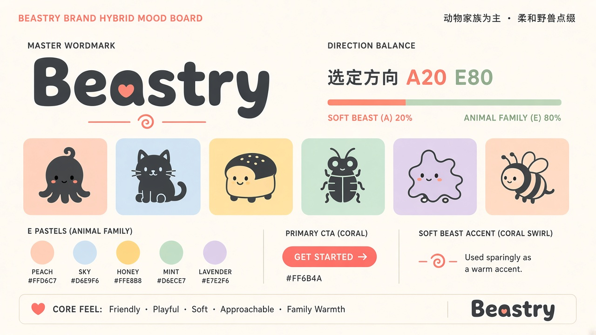

# 品牌方向决策 / Brand Decision

| 项目 | 内容 |
|------|------|
| 日期 | 2026-11-01（Asia/Shanghai） |
| 决策人 | Neil（[@neardws](https://github.com/neardws)） |
| 选定方案 | **A 20% + E 80%**（柔和野兽点缀 + 动物家族为主） |
| 讨论 | [Issue #1](https://github.com/Beastry/brand/issues/1) |

## 主体（80%）：E · Animal Family 动物家族

- 多产品吉祥物体系：母品牌 Beastry + 每个产品一只抽象小动物
- 圆润、友好、可爱，粗圆角无衬线字标
- 柔和粉彩（pastel）作为系统色，每个产品分配一个主题色

## 点缀（20%）：A · Soft Beast 柔和野兽

- 珊瑚色 Coral `#FF6B4A`：只用于**主 CTA 按钮**和**小型标记点缀**（如字标里的小心形、旋涡标记）
- 奶油色 Cream `#FFF6EE`：页面底色，带来温暖感
- 炭黑 Charcoal `#2A2421`：文字与字标

## 当前状态（v3 · 2026-11-03）

- 方向已选定；**v3 栅格定稿**在 [`final/`](final/)；SVG 手修干净路径待交付（自动描摹见 `final/svg/traced/` 归档）
- 使用指南：[`guidelines/`](guidelines/)
- 机器可读 token：[`tokens/tokens.css`](tokens/tokens.css) · [`tokens/tokens.json`](tokens/tokens.json)（日期 2026-11-03）
- 混合规则：[directions/AE-hybrid-A20-E80/NOTES.md](directions/AE-hybrid-A20-E80/NOTES.md)

## Logo v2 → v3

Neil 选定 **字标 + 书**（A20/E80）：

| 项 | 内容 |
|----|------|
| Lockup | `final/logo-lockup.jpg`（SVG 手修待替换 `final/svg/lockup.svg` 占位） |
| Mark | `final/mark.jpg`（SVG 手修待替换 `final/svg/mark.svg` 占位） |
| 动物 L→R | **粉兔 / 蓝猫 / 黄熊**（母品牌寓言兽，**≠** 产品吉祥物） |
| 矢量原则 | 手修干净路径、对齐可爱定稿；自动描摹放大发糊仅归档；几何重绘已否决 |

细节与否决路径：[`final/LOGO.md`](final/LOGO.md) · [`final/svg/README.md`](final/svg/README.md)

## 产品吉祥物（与 logo 三兽分离）

Octoshot 章鱼 · MijiaBar 猫 · mbread 面包兔 · AgentKey 甲虫 · Splatty splat · LetterBee 蜂 — 见 [guidelines/04-mascots.md](guidelines/04-mascots.md)。

## 下一步

1. 各产品确认并矢量自己的吉祥物（与母品牌三兽分开）
2. 手修 SVG 落地后官网改用矢量 mark（体积与清晰度平衡）；此前继续 JPG
3. 导出专用小尺寸 favicon / app icon 如有需要

---

*English: A20/E80 decided 2026-11-01. Brand system v3 (2026-11-03): cute wordmark+book; animals pink rabbit / blue cat / yellow bear; rasters + guidelines shipped; hand-refined SVG pending.*
