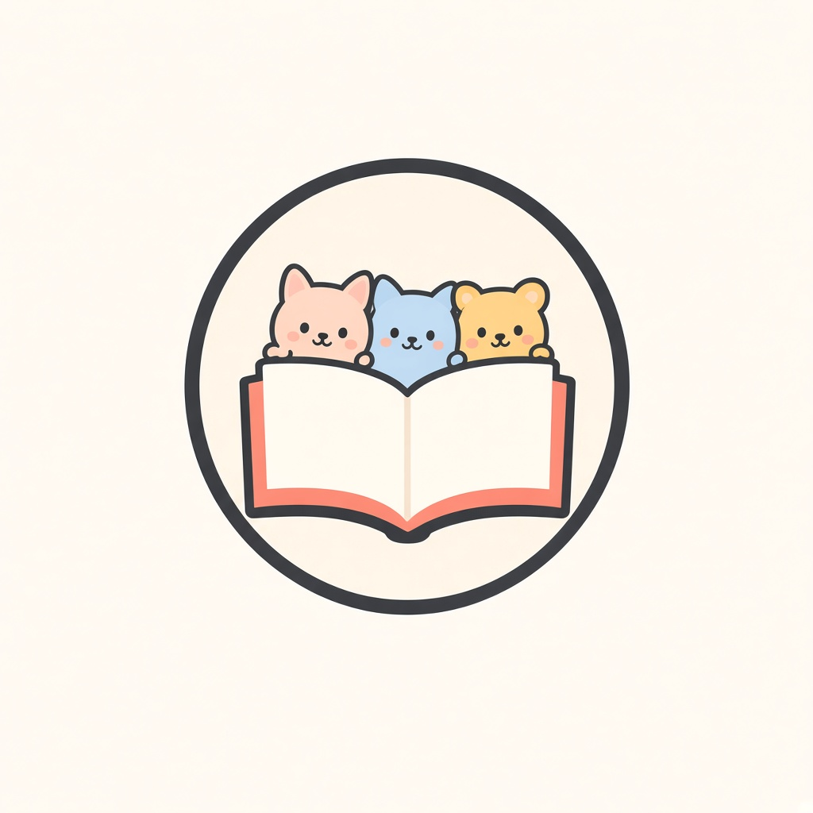
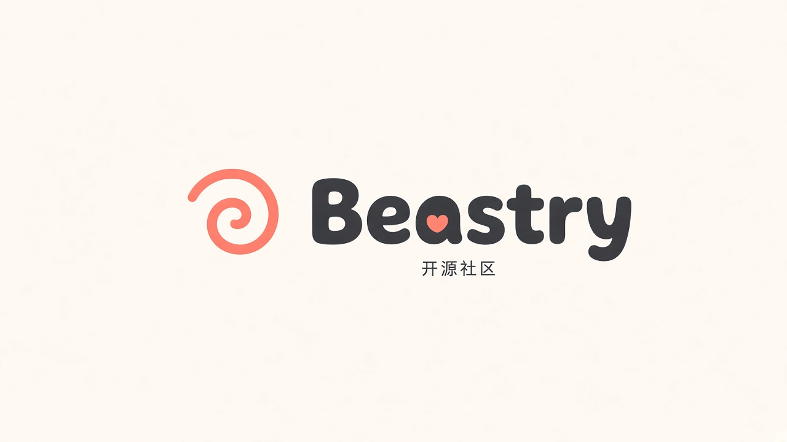

# Beastry · Brand

母品牌视觉与文案规范。官网：<https://beastry.app>

**范围：仅母品牌。** 各产品视觉由各产品自行维护。生产定稿为可爱 JPG / PNG。


---

## 品牌简述

Beastry 是面向开源与产品共创的母品牌。视觉核心是「共读的寓言书」：打开的书页上，三只寓言兽探出头来——气质温暖、可玩、清楚，对社区友好。

---

## 标志系统

| 资产 | 路径 | 说明 |
|------|------|------|
| **Mark** | [`final/mark.jpg`](final/mark.jpg) | 圆形：打开的书 + 粉兔 / 蓝猫 / 黄熊（左→右；蓝猫内耳珊瑚色） |
| **Lockup** | [`final/logo-lockup.jpg`](final/logo-lockup.jpg) | Mark + 小写字标 `beastry`（字母 *a* 字怀为珊瑚色心形） |
| **App 图标** | [`brand-book/exports/app-icon-1024.png`](brand-book/exports/app-icon-1024.png) | 1024×1024 · 奶油底圆角方标 · 无外圈 · 放大插画 |
| **Open Graph** | [`brand-book/exports/og-1200x630.png`](brand-book/exports/og-1200x630.png) | 1200×630 |
| **横幅** | [`brand-book/exports/banner-1500x320.png`](brand-book/exports/banner-1500x320.png) | 1500×320 |

细节：[final/LOGO.md](final/LOGO.md) · [guidelines/01-logo.md](guidelines/01-logo.md)

| Mark | Lockup |
|:----:|:------:|
|  |  |

**净空与尺寸（摘要）**

- 四周净空 ≥ Mark 直径的 **1/8**
- Favicon / App icon：Mark ≥ **32px**；顶栏 Mark ≥ **40px**
- Lockup：字标高 ≥ **24px**；极窄栏位改用单独 Mark + 文字「Beastry」

---

## 色彩与字体

### 色板

| 角色 | 色值 | 用法 |
|------|------|------|
| Cream | `#FFF6EE` | 页面底、浅表 |
| Charcoal | `#2A2421` | 正文、标题、结构 |
| Coral | `#FF6B4A` | 主 CTA、心形、小点缀（少用） |
| Peach · Sky · Honey · Mint · Lavender | `#FFD6C7` · `#D6E9F6` · `#FFE8B8` · `#D6ECE7` · `#E7E2F6` | 面 / 卡片 |

**规则（摘要）：** 一屏一个主珊瑚操作；粉彩只做面；正文用 Charcoal；不做珊瑚铺底 header。

机器可读 token：[`tokens/tokens.css`](tokens/tokens.css) · [`tokens/tokens.json`](tokens/tokens.json)  
规范全文：[guidelines/02-color.md](guidelines/02-color.md)

### 字体

- 字标为**图形资产**（圆角粗体小写 + 心形 *a*）；正文勿用系统字仿打官方 lockup
- 标题：粗圆角无衬线；正文：干净无衬线；代码：等宽

详见 [guidelines/03-typography.md](guidelines/03-typography.md)。

---

## 设计板 · Brand Book

完整板面与说明：[brand-book/](brand-book/) · [brand-book/NOTES.md](brand-book/NOTES.md)

| # | 板面 | 内容 |
|---|------|------|
| 01 | [01-cover.png](brand-book/01-cover.png) | 封面 |
| 02 | [02-logo-system.png](brand-book/02-logo-system.png) | 标志系统 |
| 03 | [03-color.png](brand-book/03-color.png) | 色彩 |
| 04 | [04-typography.png](brand-book/04-typography.png) | 字体 |
| 05 | [05-do-dont.png](brand-book/05-do-dont.png) | 可以 / 不要 |
| 06 | [06-applications.png](brand-book/06-applications.png) | 应用示意 |
| 07 | [07-fable-beasts.png](brand-book/07-fable-beasts.png) | 寓言三兽 |
| 08 | [08-voice.png](brand-book/08-voice.png) | 语气 |

导出资产见 [`brand-book/exports/`](brand-book/exports/)。

---

## 寓言三兽

母品牌标志内仅此三兽：

1. **粉兔** — 好奇与轻盈  
2. **蓝猫** — 专注与陪伴（珊瑚内耳）  
3. **黄熊** — 稳妥与守护（与打开的书同框）

详见 [guidelines/04-fable-beasts.md](guidelines/04-fable-beasts.md)。

---

## 使用原则（高阶）

**可以**

- 奶油底 / 白底上使用全彩 Mark 或 Lockup  
- Header 用 Mark；Hero / 宣传用 Lockup  
- 深色底对比不足时，优先加浅色衬底圆，而非随意改色  

**不要**

- 拆开三兽单独当作母品牌 logo  
- 拉伸、斜切、加立体投影，或改成尖锐几何描边  
- 取消或替换字标心形；用其他稿替换可爱 JPG 定稿  
- 让珊瑚主导版面（大面积底、整页 header）  
- 将本仓库规范扩展为各产品吉祥物映射（产品侧自行维护）  

板面示意：[brand-book/05-do-dont.png](brand-book/05-do-dont.png) · 全文：[guidelines/](guidelines/)

---

## 语气

温暖 · 可玩 · 清楚 · 开源友好。短句、主动语态；承认限制并给出下一步。避免神话式口号。

详见 [guidelines/05-voice.md](guidelines/05-voice.md) · [brand-book/08-voice.png](brand-book/08-voice.png)。

---

## 仓库结构

```
brand/
├── brand-book/   # 设计板 01–08 + NOTES + exports
├── final/        # 生产定稿（mark / lockup JPG）
├── guidelines/   # 使用指南
└── tokens/       # CSS / JSON 色与字阶 token
```

| 入口 | 说明 |
|------|------|
| [guidelines/](guidelines/) | Logo · 色 · 字 · 三兽 · 语气 · 应用 |
| [final/](final/) | 定稿资产与 [LOGO.md](final/LOGO.md) |
| [brand-book/](brand-book/) | 设计板与导出 |
| [tokens/](tokens/) | 色与字阶 token |

---

## English summary

**Beastry** is the mother brand for an open, co-creative product family. The visual core is a shared fable book: an open book with three beasts—**pink rabbit / blue cat / yellow bear** (left→right; blue cat’s inner ears coral).

- **Production masters:** cute JPG — [`final/mark.jpg`](final/mark.jpg) · [`final/logo-lockup.jpg`](final/logo-lockup.jpg); app icon / OG / banner under [`brand-book/exports/`](brand-book/exports/).
- **Scope:** mother brand only. Product-level mascots are owned by each product, not this repo.
- **Boards:** [`brand-book/`](brand-book/) 01–08 · **Guidelines:** [`guidelines/`](guidelines/) · **Tokens:** [`tokens/`](tokens/).

Site: <https://beastry.app>
