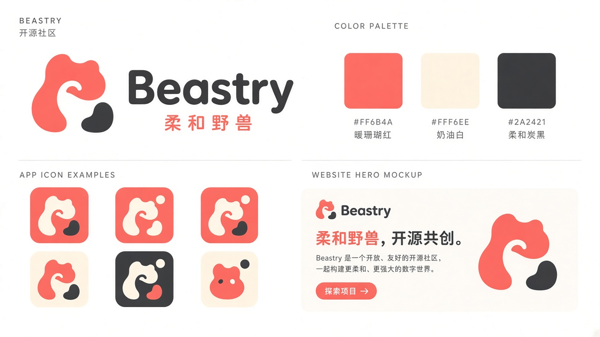
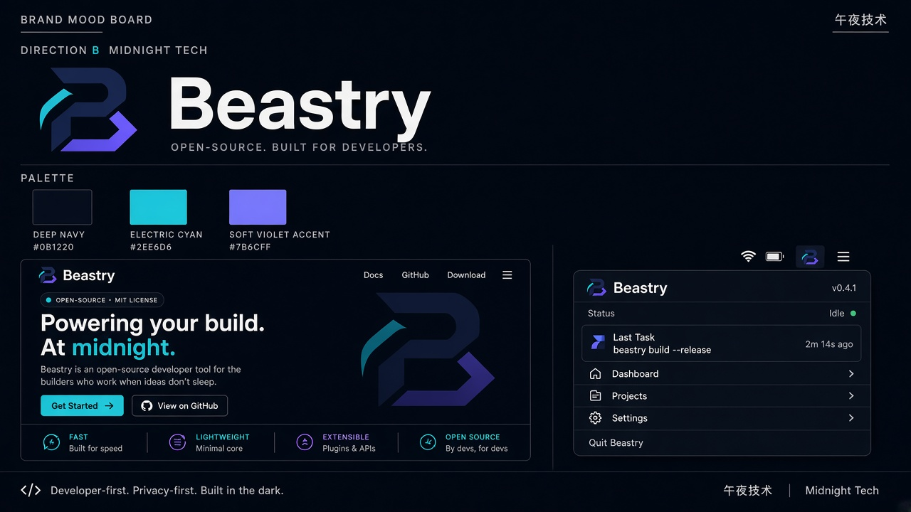
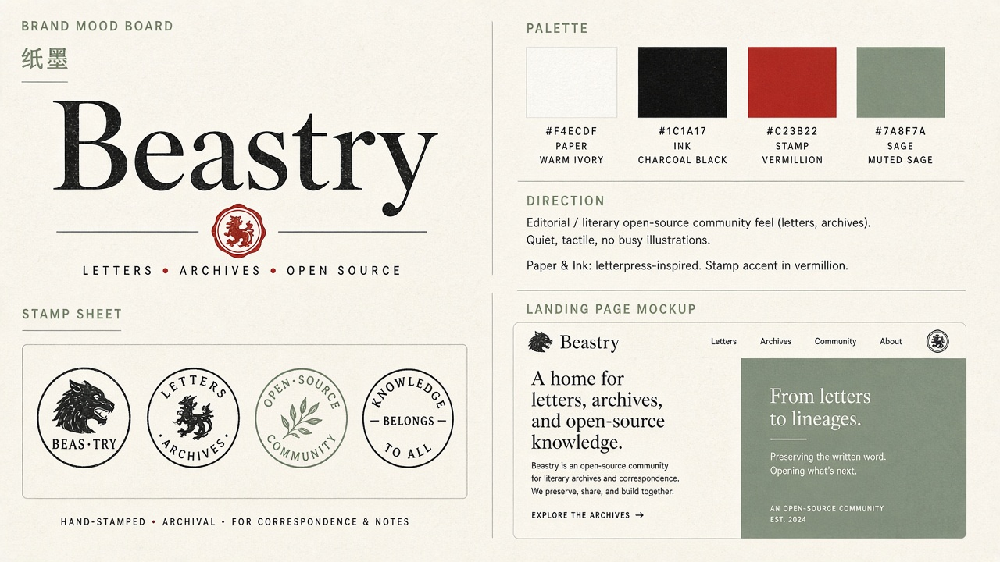
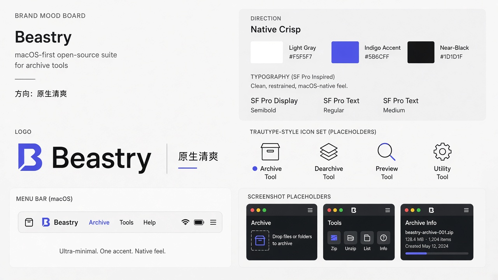
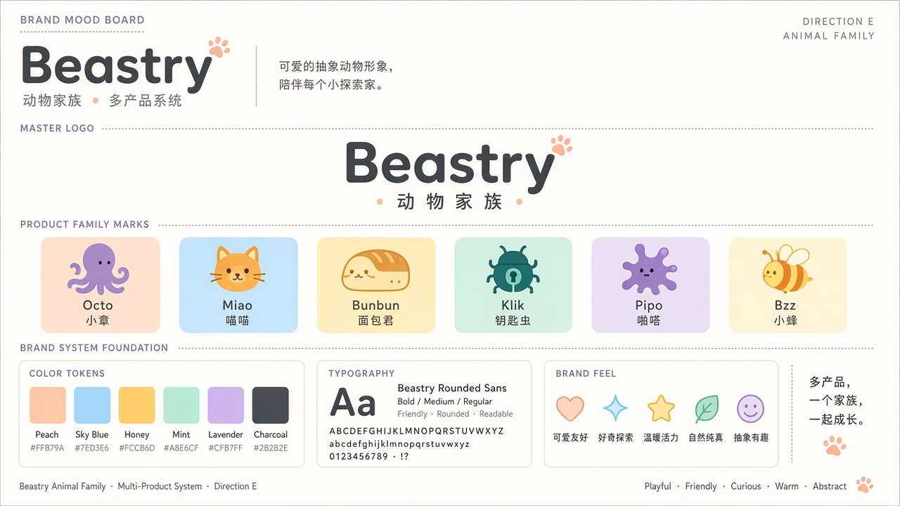

# Beastry 品牌形象探索

> ## ✅ 已选定：A 20% + E 80%
>
> 2026-11-01 Neil（@neardws）选定 **动物家族为主（E 80%）+ 柔和野兽点缀（A 20%）**。
>
> - 决策记录：[DECISION.md](DECISION.md)
> - 混合方案与使用规则：[directions/AE-hybrid-A20-E80/](directions/AE-hybrid-A20-E80/)
> - **v1 栅格定稿**：[final/](final/)（lockup / mark / mascots / hero mock）
> - Token：[`tokens/tokens.css`](tokens/tokens.css) · [`tokens/tokens.json`](tokens/tokens.json)（草案见 [proposed-tokens.md](tokens/proposed-tokens.md#选定-token-草案)）
> - 讨论：[Issue #1](https://github.com/Beastry/brand/issues/1)
>
> SVG logo 仍在打磨；`final/` 为 v1 栅格资产，可供官网使用。

---

## 探索存档（A–E）

> 以下为选定前的五个探索方向，保留作参考。

> 这些是探索稿，不是最终品牌。

Beastry 官网：<https://beastry.app>

### 五个方向一览

| ID | 方向 | 气质 | 主色 | 形象板 |
|----|------|------|------|--------|
| A | Soft Beast 柔和野兽 | 温暖、友好的社区感 | Coral `#FF6B4A` · Cream `#FFF6EE` · Charcoal `#2A2421` | [查看](directions/A-soft-beast/) |
| B | Midnight Tech 午夜技术 | 深色、开发者优先 | Navy `#0B1220` · Cyan `#2EE6D6` · Violet `#7B6CFF` | [查看](directions/B-midnight-tech/) |
| C | Paper & Ink 纸墨 | 编辑 / 活字印刷 / 档案感 | Paper `#F4ECDF` · Ink `#1C1A17` · Stamp `#C23B22` · Sage `#7A8F7A` | [查看](directions/C-paper-ink/) |
| D | Native Crisp 原生清爽 | macOS 原生、克制 | Gray `#F5F5F7` · Indigo `#5B6CFF` · Near-black `#1D1D1F` | [查看](directions/D-native-crisp/) |
| E | Animal Family 动物家族 | 多产品吉祥物体系 | Peach / Sky / Honey / Mint / Lavender + Charcoal | [查看](directions/E-animal-family/) |

| A 柔和野兽 | B 午夜技术 | C 纸墨 |
|---|---|---|
|  |  |  |

| D 原生清爽 | E 动物家族 |
|---|---|
|  |  |

配色对比见 [tokens/proposed-tokens.md](tokens/proposed-tokens.md)。

## Beastry 旗下产品

组织 [Beastry](https://github.com/Beastry) 下的产品仓库：

- [Octoshot](https://github.com/Beastry/Octoshot)
- [MijiaBar](https://github.com/Beastry/MijiaBar)
- [jiyi-mianbao](https://github.com/Beastry/jiyi-mianbao)（记忆面包）
- [AgentKey](https://github.com/Beastry/AgentKey)
- [Splatty](https://github.com/Beastry/Splatty)
- [LetterBee](https://github.com/Beastry/LetterBee)
- [Stow](https://github.com/skyswordw/stow)（暂在 `skyswordw/stow`，尚未迁入组织）
- 官网：[beastry.app](https://github.com/Beastry/beastry.app)

### 怎么给意见（已选定，保留存档）

请 @neardws 和 @skyswordw 看一下：

1. **挑一个最喜欢的方向**（A–E），或者
2. **混搭**——例如「D 的系统感 + E 的产品吉祥物」、「A 的配色 + C 的印章 logo」；
3. 对具体元素（logo、配色、字体、语气）有意见，直接开 Issue 或在对应方向的 `NOTES.md` 上评论 / 提 PR。

选定后下一步：细化 logo（矢量）、确定 design tokens、出 app icon 与官网落地规范。

---

*English: Selected 2026-11-01 — 80% E Animal Family + 20% A Soft Beast (see DECISION.md). The five A–E exploration boards are kept below as an archive.*
