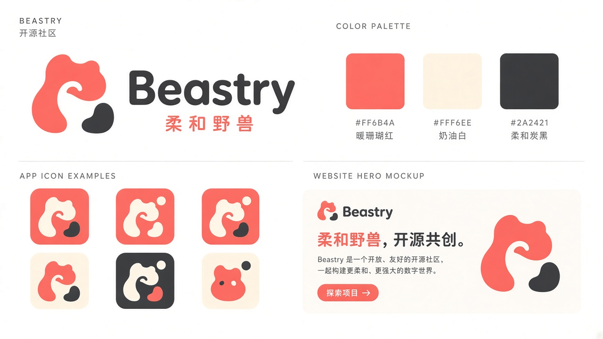

# A · Soft Beast 柔和野兽

## 定位
温暖、友好、有点可爱的开源社区形象。「野兽」被处理成圆润的小兽剪影，弱化攻击性，强调陪伴与共创。

## 适合场景
- 面向普通用户 / 社区的产品与官网
- 需要亲和力的社交传播（头像、贴纸、周边）
- 中文语境下的「柔和野兽，开源共创」口号

## 标志思路
- 珊瑚色有机形状的小兽轮廓 + 一块炭黑「斑点」，可单独作为 app icon
- 字标用圆角无衬线粗体，中文副标「柔和野兽」
- 图标可在珊瑚底 / 奶油底 / 炭黑底三种背景下切换

## 配色
- Coral `#FF6B4A`（主色）
- Cream `#FFF6EE`（底色）
- Charcoal `#2A2421`（文字 / 深色）

## 风险 / 不适用
- 对开发者工具类产品（AgentKey、Octoshot）可能显得「太软」，专业感不足
- 有机形状在小尺寸（16px 菜单栏图标）辨识度一般，需要另做简化版
- 珊瑚橙在暗色模式下需要调亮度，否则对比度偏弱
