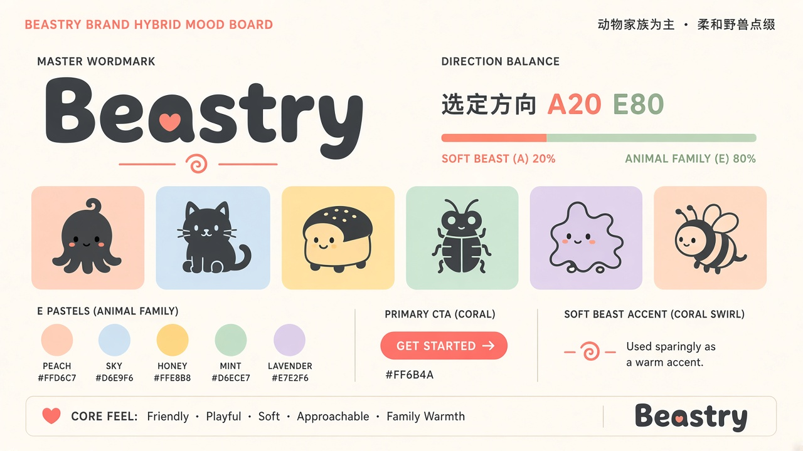

# AE · 混合方案 A20 / E80（已选定）

> 决策记录见 [DECISION.md](../../DECISION.md)。形象板为规划参考，非最终 SVG。

## 一句话
**动物家族为主，柔和野兽点缀。** 吉祥物家族是主角，珊瑚色只是一点温暖的强调。

## 来自 E（80%）
- 母品牌字标：粗圆角无衬线「Beastry」，炭黑色
- 产品动物家族：每个产品一只抽象小动物（形象板示例：章鱼、猫、面包、甲虫、云团、小蜂），名称与对应关系待逐个确认
- 粉彩系统色：Peach / Sky / Honey / Mint / Lavender 作为产品主题色与卡片背景
- 整体气质：友好、可玩、柔软、亲近、有家庭感

## 来自 A（20%）
- Coral `#FF6B4A`：主 CTA 按钮（如「Get Started」）、字标中的小心形、珊瑚旋涡小标记
- Cream `#FFF6EE`：页面 / 画布底色
- Charcoal `#2A2421`：正文与字标颜色
- 圆润有机的线条感（与 E 的圆角风格天然契合）

## 使用规则
- 一屏之内珊瑚色只出现在 **1 个主操作** + 少量小点缀上
- 动物形象和粉彩卡片永远是视觉主角（hero）
- 粉彩用作背景 / 面，不用作文字颜色；文字统一用 Charcoal
- 每个产品固定一个粉彩主题色，不混用

## 不要做
- ❌ 不要让珊瑚色占主导：不要用珊瑚做大面积背景、整页 header 或产品主题色
- ❌ 不要用 A 的小兽剪影替代或抢占动物家族的位置
- ❌ 不要把粉彩调饱和、调深，失去柔和感
- ❌ 不要在同一个产品上同时堆叠多种粉彩
- ❌ 不要用尖锐几何 / 霓虹 / 深色科技风（B）元素
