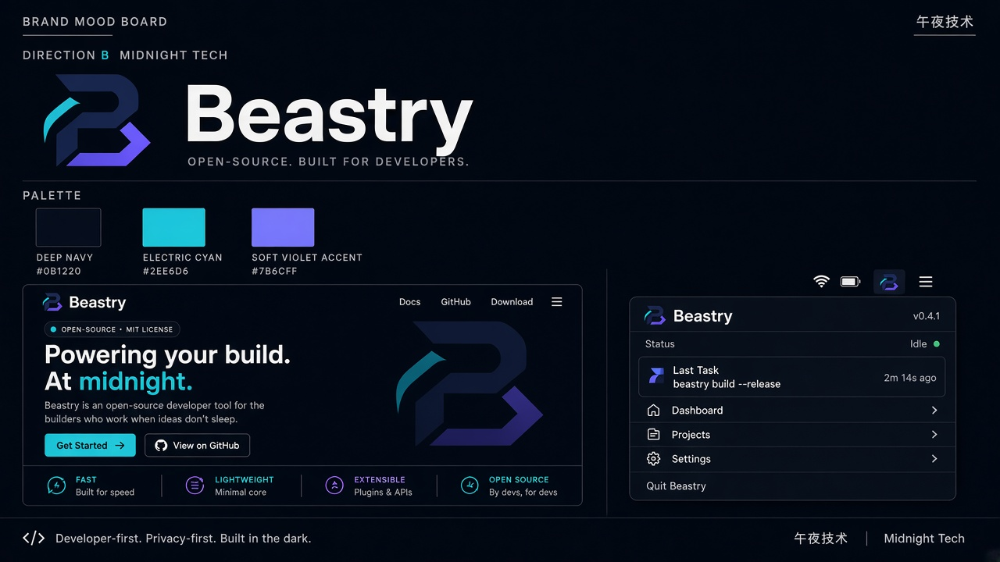

# B · Midnight Tech 午夜技术

## 定位
深色、利落、开发者优先。传达「为深夜写代码的人打造的工具」，强调速度、轻量、开源、可扩展。

## 适合场景
- 开发者工具、CLI、菜单栏工具（AgentKey、Octoshot 等）
- GitHub README、文档站、发布页
- 暗色模式为主的产品界面

## 标志思路
- 几何化的「B」字母标，带青色切角与紫色箭头，暗示「构建 / 前进」
- 字标用粗体无衬线，配副标「Open-source. Built for developers.」
- 菜单栏单色版可直接用 B 字形

## 配色
- Navy `#0B1220`（背景）
- Cyan `#2EE6D6`（主强调色）
- Violet `#7B6CFF`（次强调色）

## 风险 / 不适用
- 「深色 + 霓虹」在开发者工具圈很常见，差异化有限
- 对记忆面包、纸短情长（LetterBee）这类偏生活 / 情感的产品气质不匹配
- 亮色模式需要额外设计一套，不能直接反色
- 「Beastry」中的「兽」意象几乎消失
