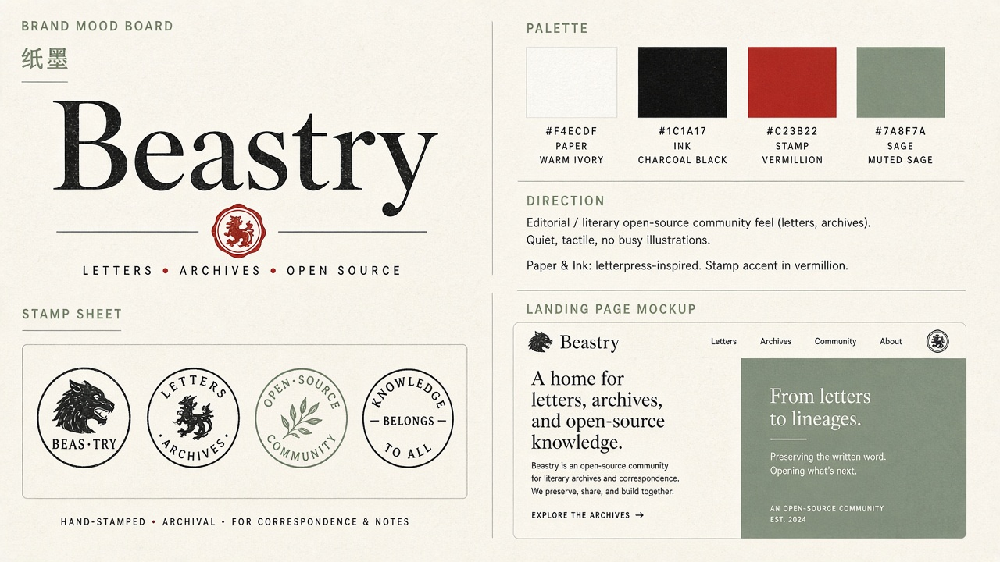

# C · Paper & Ink 纸墨

## 定位
编辑感、文学感、活字印刷与档案气质。安静、有质感、少插画，像一封盖了火漆印的信。

## 适合场景
- 偏内容 / 记录 / 书信类产品（LetterBee 纸短情长、记忆面包）
- 品牌故事页、博客、长文
- 印章可延展为实体周边（明信片、贴纸、封蜡）

## 标志思路
- 大号衬线字标「Beastry」
- 朱红圆形印章，内含纹章风格的小兽，可作为独立图形标
- 一套「印章表」：不同文字环绕的徽章，可分配给不同产品 / 栏目

## 配色
- Paper `#F4ECDF`（纸底）
- Ink `#1C1A17`（墨色文字）
- Stamp `#C23B22`（朱红印章）
- Sage `#7A8F7A`（灰绿辅助）

## 风险 / 不适用
- 对 macOS 工具、开发者工具显得偏「复古 / 文艺」，科技感不足
- 纹章小兽细节多，小尺寸 icon 需要大幅简化
- 衬线字在 UI 小字号下可读性一般，正文需另配无衬线
