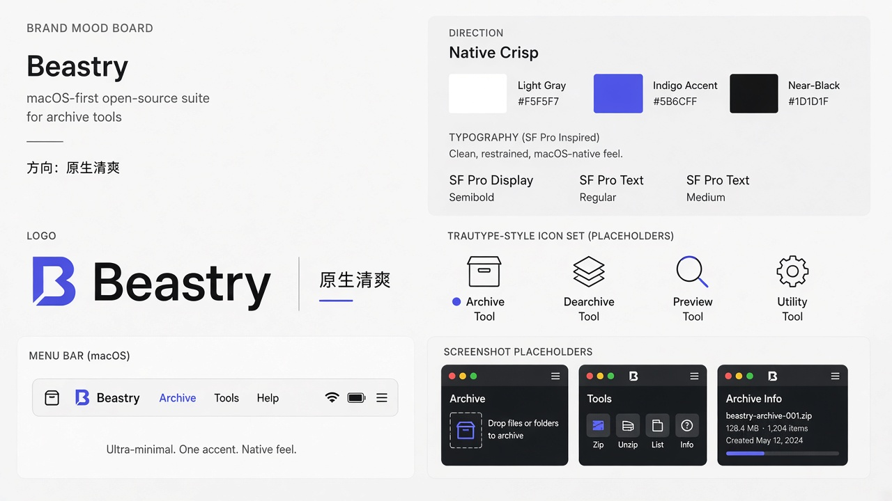

# D · Native Crisp 原生清爽

## 定位
macOS 原生、极简、克制。只有一个强调色，看起来像系统自带的工具，让产品本身成为主角。

## 适合场景
- macOS 菜单栏 / 桌面工具（MijiaBar、Stow、Octoshot 等）
- 需要和系统 UI 无缝融合的界面
- 作为整个产品线的「底层设计系统」，与其他方向（如 E）叠加

## 标志思路
- 靛蓝色「B」字母标，简洁几何，带一个小切口
- 字标用 SF Pro 风格无衬线，中文副标「原生清爽」
- 图标线性、统一笔画，与 SF Symbols 风格接近

## 配色
- Gray `#F5F5F7`（背景）
- Indigo `#5B6CFF`（唯一强调色）
- Near-black `#1D1D1F`（文字）

## 风险 / 不适用
- 太克制，品牌记忆点弱，容易「像 Apple 的模板」
- 「野兽」意象缺失，名字和形象之间没有关联
- 非 Apple 平台（Web、Windows）上原生感会减弱
- 适合当系统底座，单独作为品牌主形象可能不够有个性
