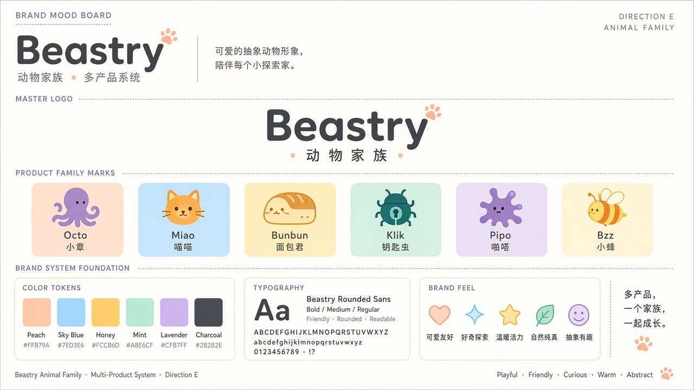

# E · Animal Family 动物家族

## 定位
「多产品，一个家族，一起成长。」母品牌 Beastry 统一字标，每个产品配一只抽象小动物，形成可扩展的吉祥物体系。

## 适合场景
- 产品线较多、各自独立又需要统一归属感（正是 Beastry 现状）
- App icon、产品官网、社交传播、贴纸周边
- 可与 D（原生清爽）结合：D 做界面系统，E 做品牌与产品识别

## 标志思路
- 母品牌：圆角无衬线字标 + 小爪印点缀，副标「动物家族」
- 产品形象（形象板中的示例）：Octo 小章、Miao 喵喵、Bunbun 面包君、Klik 钥匙虫、Pipo 啪嗒、Bzz 小蜂
- 每个产品分配一个主题色作为背景

## 配色
- Peach / Sky / Honey / Mint / Lavender（产品主题色）+ Charcoal（文字与字标）
- 具体色值待选定方向后再定稿

## 风险 / 不适用
- 角色设计和维护成本最高，每加一个产品都要新画一只
- 形象板中的动物名称和对应关系是占位，需逐个和产品负责人确认
- 整体偏可爱，对偏专业的开发者工具可能需要更收敛的版本
- 多色并存时需要严格的使用规范，否则容易显得杂乱
